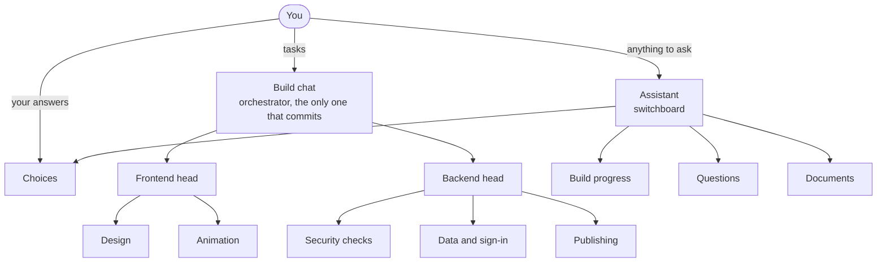
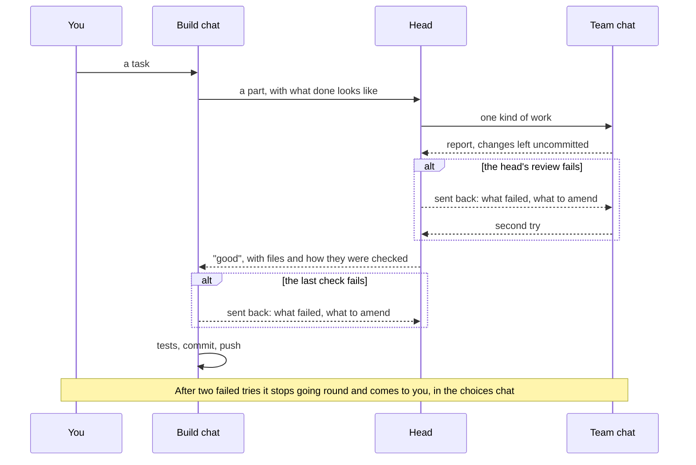

# Chat pyramid

A skill for Claude Code that runs one project with many chats as a small company: one build chat at the top that
orchestrates and commits, a head for each department that reviews, team chats that each do one kind of work, and an
assistant that routes your questions. Work moves up only after another chat has checked it, and work that fails a
check is sent back with what to amend.

It grew out of building a study app with about twenty chats on one folder, after the usual problems showed up: two
chats committing at once, the same question asked in three places, and work reported as done that nobody had checked.

## The chart



| Level | Chat | Does |
|---|---|---|
| Top | Build chat | Takes your tasks, splits them, hands parts to the heads, does the last check, commits and pushes. Writes no feature code |
| Heads | Frontend, Backend (or your own departments) | Own their side's files, split work among their team, review and test what comes back |
| Team chats | One kind of work each | Their part of the project in work; report to their head |
| Assistant | Switchboard | Passes your words to the chat that can answer, replies with that chat's name |
| Assistant's chats | Choices, Build progress, Questions, Documents | One job each, see below |

You talk to three chats: the build chat, the choices chat and the assistant.

## How work moves up, and how it is sent back



1. A team chat does its part, runs the tests for its files, leaves the change uncommitted and reports to its head.
2. The head reviews it, runs the tests and, for a visual change, looks at screenshots.
3. If it fails, the head sends it back to the same chat with two things: what failed, and what to amend. A large
   piece is split into smaller parts first.
4. If it passes, the head tells the build chat it is good.
5. The build chat does the last check and commits. If that check fails, it goes back to the head the same way.
6. After two failed tries the work goes to you through the choices chat, instead of a third round.

## Where each thing is shown

Each thing appears in one chat only, so you always know where to look.

| Thing | The one chat that shows it |
|---|---|
| A choice for you | Choices: a small table; your answer is written to a decisions file and passed back |
| A document, list, screenshot or picture you ask for | Documents: the thing itself, no commentary |
| The answer to a question | Questions: reads chats and files, changes nothing |
| Where the build stands | Build progress |

A chat that sent something elsewhere says so at the end of its reply and does not repeat it:

```
For you: Answer choice 4 in Assistant · Choices.
Result: Sign-in screen rebuilt; page tests pass.
Sent: Assistant · Choices · choice 4, two layouts for the sign-in screen
```

## The other rules

| Rule | In short |
|---|---|
| Only the build chat commits | Several chats edit one folder; two committing at once clash |
| Questions come from the top | A worker asks its head; only the build chat and the heads ask you, and only in Choices |
| Teams by kind of work | A designer, a security engineer; never one chat per feature |
| One project at a time | You name it; every chat works on that until you name the next |
| Hand-over notes | Each chat keeps a note, so its replacement does not start from nothing |

The reasons for each are in [SKILL.md](SKILL.md).

## Install

Clone this repository into your skills folder (for all your projects):

```bash
git clone https://github.com/YoungChicken880-cpu/chat-pyramid.git ~/.claude/skills/chat-pyramid
```

Or into one project, as `.claude/skills/chat-pyramid`.

## Set it up in a project

1. Open a chat in your project. This one becomes the build chat.
2. Type: `Set this project up with the chat-pyramid skill.`
3. Claude lists your departments and which files each owns, and asks you to confirm.
4. It adds the section from [templates/CLAUDE-section.md](templates/CLAUDE-section.md) to your `CLAUDE.md` and
   creates `docs/current-project.md`, `docs/chats/` and `plans/decisions.md`.
5. It starts the heads and the assistant. Each head then offers its team chats as cards for you to click.
6. Name your first project to the build chat.

## Files

| File | What it is |
|---|---|
| `SKILL.md` | The skill: the shape, the rules with their reasons, the set-up steps, what each chat does on a turn |
| `templates/CLAUDE-section.md` | The section for your project's `CLAUDE.md`; this is what every chat reads |
| `templates/hand-over-note.md` | The seven parts of a chat's hand-over note |
| `templates/current-project.md` | The file that names the one project in work |

## Limits

Checked in the Claude desktop app in November 2026.

- A chat can start another chat only on a turn you typed in that chat, or through a card you click. Chats cannot
  start chats on each other's messages.
- The sidebar nests a chat under the chat that started it, and it cannot be moved under another later.
- Chats share no memory. What must last goes into files.
- Many chats use many tokens. For a small project, one chat is cheaper and enough.

## Licence

MIT, see [LICENSE](LICENSE).
